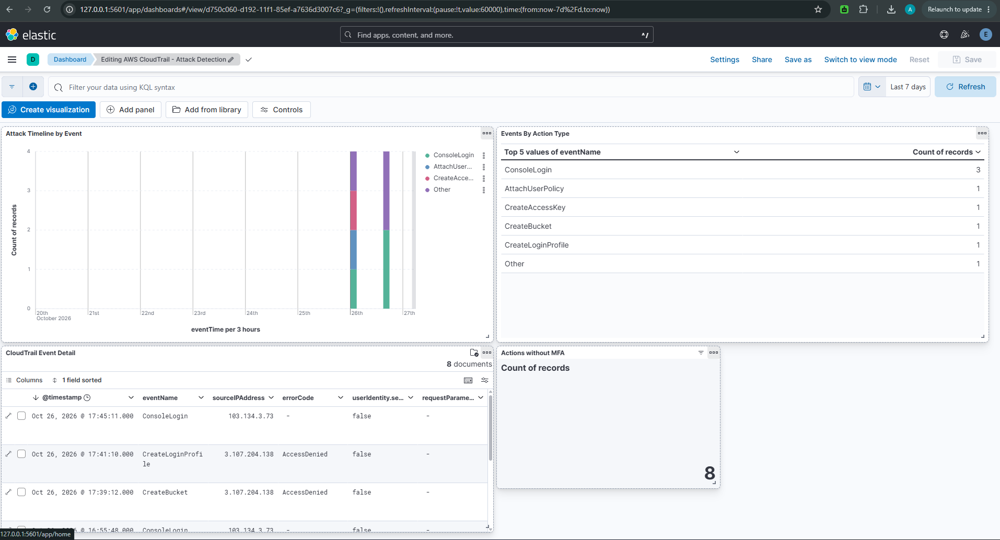

# AWS CloudTrail Attack Detection Lab

Detecting cloud identity attacks using AWS CloudTrail log analysis and a self-hosted ELK SIEM — a hands-on blue-team project built in a live AWS account.

> **Scope note (read first):** This lab was built in an AWS Free-plan account that sits inside an AWS-managed Organization with restrictive **Service Control Policies (SCPs)**. Several services (S3 bucket creation, EC2, GuardDuty, IAM login profiles) were blocked at the org level. Rather than abandon the lab, I **adapted the attack plan to the actions the environment allowed** and focused on what matters most in real cloud breaches anyway: **identity-based attacks** and their detection. Working within environmental constraints is itself part of the job.

---

## What this project demonstrates

- Reading and interpreting raw **AWS CloudTrail** events (the cloud equivalent of endpoint/SIEM logs)
- Detecting an **identity persistence attack** (rogue admin user creation + key generation)
- Detecting an **account discovery / enumeration** attack (reconnaissance burst)
- Recognising **denied escalation attempts** (SCP `AccessDenied` events) as intent signals
- Distinguishing attacker **reconnaissance (`readOnly: true`)** from **action (`readOnly: false`)**
- Correlating events by **identity** rather than source IP (and why that matters)
- Ingesting CloudTrail logs into a self-hosted **ELK stack** and building a **detection dashboard**
- Mapping observed activity to **MITRE ATT&CK**
- Writing analyst-grade findings and response recommendations

---

## Environment

| Component | Detail |
|---|---|
| Cloud | AWS (Free plan, credit-based) |
| Account type | Member of an AWS-managed Organization (SCP-restricted) |
| Primary log source | AWS CloudTrail (management events, first copy — free) |
| Attacker tooling | AWS CloudShell + AWS CLI (ran from inside the account) |
| Analyst tooling | CloudTrail Event history console **+ self-hosted ELK (Elasticsearch + Kibana)** |
| Billing guardrail | AWS Budgets zero/low-spend alert |
| Account hardening | MFA enabled on root and daily (Identity Center) login |
| Region note | IAM is a **global** service — all IAM events log to **us-east-1** regardless of where the command ran |

---

## Attacks & detections

| # | Attack | MITRE Tactic | Technique | CloudTrail evidence | `readOnly` |
|---|---|---|---|---|---|
| 1 | Rogue admin user (persistence backdoor) | Persistence | T1136.003, T1098 | `CreateUser`, `AttachUserPolicy`, `CreateAccessKey` | false |
| 2 | Account enumeration (reconnaissance) | Discovery | T1087.004, T1069.003 | `ListUsers`, `ListRoles` | true |
| — | Denied escalation attempts | Persistence (attempted) | T1098, T1578 | `CreateLoginProfile`, `CreateBucket` (SCP `AccessDenied`) | false |

Full write-ups:
- [`cases/attack-01-rogue-iam-user/analysis.md`](cases/attack-01-rogue-iam-user/analysis.md)
- [`cases/attack-02-discovery/analysis.md`](cases/attack-02-discovery/analysis.md)

Supporting docs:
- [`methodology.md`](methodology.md) — how the detection was done, repeatably
- [`iocs/iocs.md`](iocs/iocs.md) — indicators observed
- [`teardown.md`](teardown.md) — how the lab was cleaned up

---

## SIEM Detection (ELK)

Beyond console-based investigation, the same CloudTrail events were ingested into a self-hosted **ELK stack** (Elasticsearch + Kibana) and visualised in a detection dashboard — showing the attacks as an analyst would see them in a SIEM, not one event at a time.

- Pipeline: CloudTrail export → NDJSON → Kibana file upload → `cloudtrail-lab` index → dashboard
- Dashboard panels: attack timeline, events-by-action, no-MFA metric, per-event detail (with `errorCode` exposing denied escalation attempts)
- Full write-up: [`siem-elk/README.md`](siem-elk/README.md)

---

## Key findings

1. **A rogue admin was created and granted `AdministratorAccess` within ~4 minutes**, then issued its own access key. The danger isn't the user creation alone — it's the *sequence* `CreateUser` → `AttachUserPolicy` → `CreateAccessKey`. Alert on the pattern, not the single event.
2. **An enumeration burst followed from the same identity** — `ListUsers`, `ListRoles`, etc. in a short window: classic post-compromise orientation.
3. **Escalation attempts were blocked by SCPs** (`CreateLoginProfile`, `CreateBucket` → `AccessDenied`). Failed attempts still log, and still reveal intent.
4. **All privileged actions ran with `mfaAuthenticated: false`** — a recurring control gap, surfaced as a standing metric in the dashboard.
5. **The same actor appeared under multiple source IPs** across CloudShell sessions. Hunting by IP would split one actor into two; the reliable pivot is the **identity** (`principalId` / role ARN).

---

## Skills shown

AWS CloudTrail · log analysis · ELK / Elasticsearch / Kibana · SIEM dashboarding · MITRE ATT&CK mapping · cloud IAM · identity-based threat detection · incident timeline reconstruction · detection-pattern reasoning · working within SCP-constrained environments

## How this fits my wider lab

This complements my on-prem SOC lab (ELK/Elastic Stack, Sysmon, Mythic C2 detection) by extending the same **attack → telemetry → detection → MITRE mapping** loop into the cloud/API-plane, where the log source is CloudTrail rather than endpoint logs — and routes cloud logs into the same kind of SIEM used on-prem.
