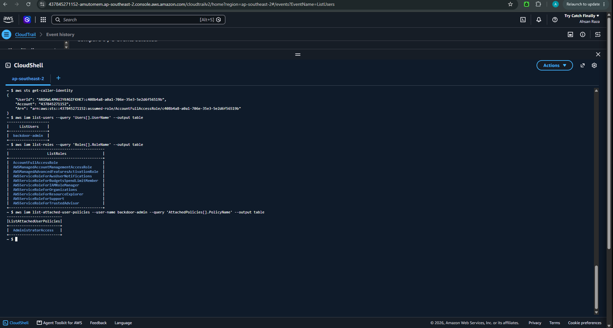
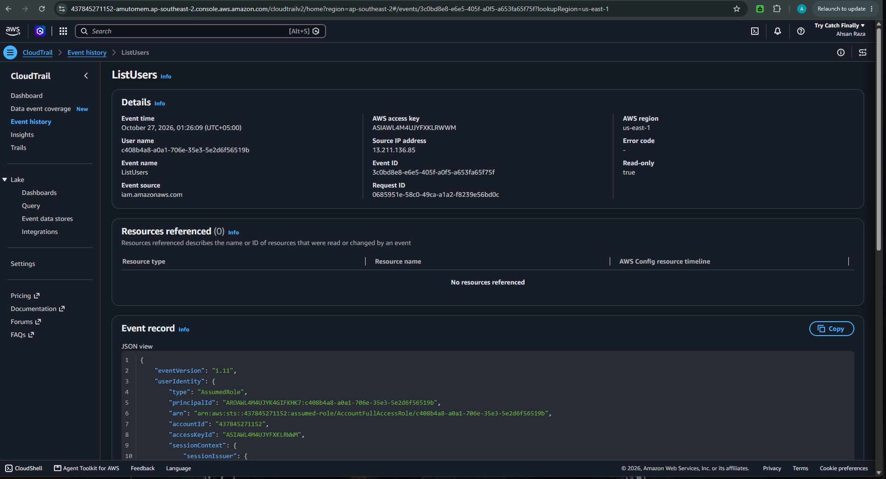
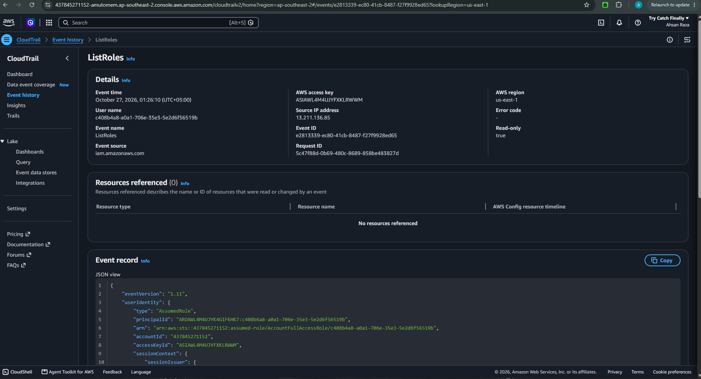

# Attack 02 — Account Enumeration (Reconnaissance / Discovery)

## Summary

| | |
|---|---|
| **Verdict** | Malicious — confirmed |
| **Severity** | Medium (recon precedes action) |
| **Tactic** | Discovery (TA0007) |
| **Techniques** | T1087.004 Account Discovery: Cloud Account · T1069.003 Permission Groups Discovery: Cloud Groups |
| **Actor** | `AccountFullAccessRole`, userId `c408b4a8-a0a1-706e-35e3-5e2d6f56519b` |
| **Date** | 2026-10-26 (UTC) |

**One line:** The same compromised identity ran a burst of read-only IAM enumeration calls to map the account's users, roles and permissions before taking further action.

---

## Scenario

After establishing persistence (Attack 01), the attacker "orients" — they map what exists in the account: which identities, what each can do, what resources are present. This is the normal post-compromise step before privilege escalation or data theft. Every call is **read-only**, which makes it quieter than Attack 01 but still detectable.

---

## Attack steps (attacker side)

Run from AWS CloudShell:

```bash
aws sts get-caller-identity               # who did I compromise?
aws iam list-users                        # what other identities exist?
aws iam list-roles                        # what roles exist / who trusts whom?
aws iam list-attached-user-policies --user-name backdoor-admin   # what can my backdoor do?
aws ec2 describe-instances                # any compute to target?  -> SCP DENIED
aws s3 ls                                 # any buckets/data?        -> empty
```

Results confirmed: one IAM user (`backdoor-admin`, admin), full role map including two roles trusting external account `355312713211` (revealing this is an org-managed account), EC2 blocked by SCP, no S3 buckets.



---

## Detection (analyst side)

Source: **CloudTrail → Event history**, region **us-east-1**. Filter on each `List*` event name.

### Example event — ListUsers
```json
{
  "eventName": "ListUsers",
  "eventTime": "2026-10-26T12:49:09Z",
  "awsRegion": "us-east-1",
  "sourceIPAddress": "3.107.204.138",
  "userIdentity": { "type": "AssumedRole", "arn": ".../AccountFullAccessRole/c408b4a8-..." },
  "requestParameters": null,
  "responseElements": null,
  "readOnly": true,
  "userAgent": "... exec-env/CloudShell ... md/command#iam.list-users",
  "sessionContext": { "attributes": { "mfaAuthenticated": "false" } }
}
```




---

## Analyst observations

1. **`readOnly: true` is the distinguishing mark.** Attack 01 was `false` (state change). Attack 02 is `true` (reads). Attackers *read* (recon) before they *write* (act). Being able to split the two in CloudTrail is core triage.
2. **The burst is the signal.** A single `ListUsers` is routine. One identity running `ListUsers` + `ListRoles` + `ListAttachedUserPolicies` + `DescribeInstances` + `ListBuckets` inside a ~3-minute window is Discovery behaviour. Detection should look for *enumeration velocity* per principal, not any single call.
3. **Same actor, different IP.** Source IP here is `3.107.204.138` — different from Attack 01's `16.178.25.21`, because it's a new CloudShell session. Hunting by IP would split one actor into two; the reliable pivot is the **identity** (`principalId` / role ARN), identical across both attacks.
4. **A denial is also evidence.** The SCP-denied `DescribeInstances` still logged — telling the defender the attacker *probed* EC2 and hit a guardrail. Failed attempts map the attacker's intent.

---

## Indicators (IOCs)

| Type | Value |
|---|---|
| Actor role | `arn:aws:iam::437845271152:role/managed/AccountFullAccessRole` |
| Actor session userId | `c408b4a8-a0a1-706e-35e3-5e2d6f56519b` |
| Source IP | `3.107.204.138` (AWS CloudShell) |
| Enumeration events | `GetCallerIdentity`, `ListUsers`, `ListRoles`, `ListAttachedUserPolicies` |

---

## Recommended SOC response

- **Detect:** Alert on a threshold of distinct `List*`/`Describe*`/`Get*` IAM & recon calls from one principal within a short window (enumeration-velocity rule).
- **Correlate:** Tie recon activity to prior persistence (Attack 01) by `principalId` — the combination escalates severity.
- **Prevent:** Least-privilege (the compromised role had `AdministratorAccess`, enabling full enumeration); scope read permissions; enable anomaly detection (GuardDuty where available) for `Recon:IAMUser/*` finding types.
