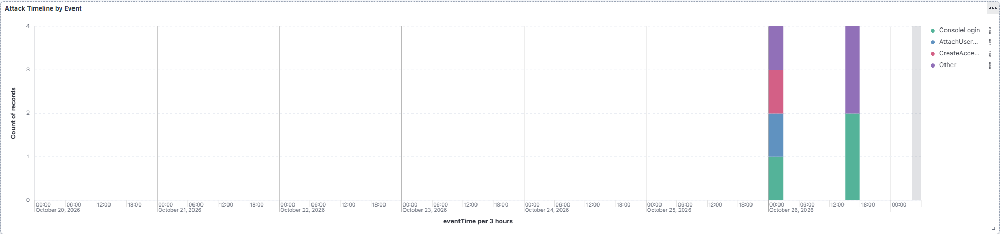
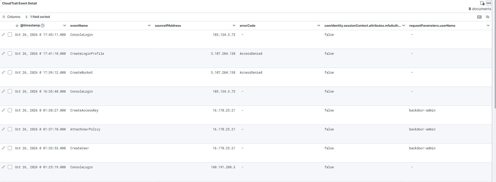

# SIEM Detection — AWS CloudTrail in ELK

This extends the console-based detection ([`../cases/`](../cases/)) by ingesting the same AWS CloudTrail events into a self-hosted **ELK stack** (Elasticsearch + Kibana) and building a detection dashboard. Same incident, second detection layer — console triage *plus* SIEM visibility.

## Why this matters

Reading events one-by-one in the CloudTrail console doesn't scale. A SOC runs detections over a SIEM: events are indexed, visualised, and surfaced as patterns. This shows the same two attacks (persistence + attempted escalation) as they'd appear to an analyst watching a dashboard.

## Pipeline

```
AWS CloudTrail (us-east-1)
   │  Download events → JSON  ({"Records":[...]})
   ▼
Host (PowerShell)  →  convert to NDJSON (one event per line)
   ▼
Kibana → Upload a file  →  index: cloudtrail-lab
   ▼
Kibana Dashboard — "AWS CloudTrail — Attack Detection"
```

> The standard live pipeline (CloudTrail → S3 → Filebeat) was unavailable: the AWS account's Service Control Policy blocks S3. A manual export→ingest path was used instead. See [`ingest-notes.md`](ingest-notes.md).

## Environment

| Component | Detail |
|---|---|
| SIEM | Elasticsearch + Kibana (self-hosted VM, `theanalyst`) |
| License | Basic (free) |
| Index | `cloudtrail-lab` |
| Data | 8 CloudTrail management events (Oct 25–26, us-east-1) |
| Time field | `eventTime` (ISO 8601) |

## The dashboard


**Panel 1 — Attack Timeline by Event.** Stacked bars over `eventTime`, broken down by `eventName`. Shows the activity sequence: logins, then the persistence chain, then the denied escalation attempts.



**Panel 2 — Events by Action Type.** Count per `eventName` — what the actor did and how often.

**Panel 3 — Actions without MFA.** Count of events where `mfaAuthenticated = false`. A recurring control gap: every privileged action ran without MFA.

**Panel 4 — CloudTrail Event Detail.** Per-event table (`eventTime`, `eventName`, `sourceIPAddress`, `errorCode`, `mfaAuthenticated`, `requestParameters.userName`). The `errorCode` column exposes the **denied** escalation attempts (`CreateBucket`, `CreateLoginProfile`) alongside the successful persistence actions.



## What the dashboard reveals

1. **Persistence chain is visible as a cluster:** `CreateUser` → `AttachUserPolicy` → `CreateAccessKey` in a tight window from one identity.
2. **Blocked escalation is logged too:** `CreateBucket` and `CreateLoginProfile` carry an `errorCode` (SCP `AccessDenied`) — failed attempts still tell you the actor's intent.
3. **No MFA on any privileged action** — surfaced as a standing metric, not buried in individual events.
4. **Single actor, correlated by identity** (`AccountFullAccessRole` session) across all events, even where source IPs differ.

## MITRE ATT&CK

| Technique | Name | Seen as |
|---|---|---|
| T1136.003 | Create Account: Cloud Account | `CreateUser` |
| T1098 | Account Manipulation | `AttachUserPolicy`, `CreateAccessKey` |
| T1098 (attempted) | Account Manipulation | `CreateLoginProfile` (denied) |
| T1578 (attempted) | Modify Cloud Compute / resources | `CreateBucket` (denied) |
